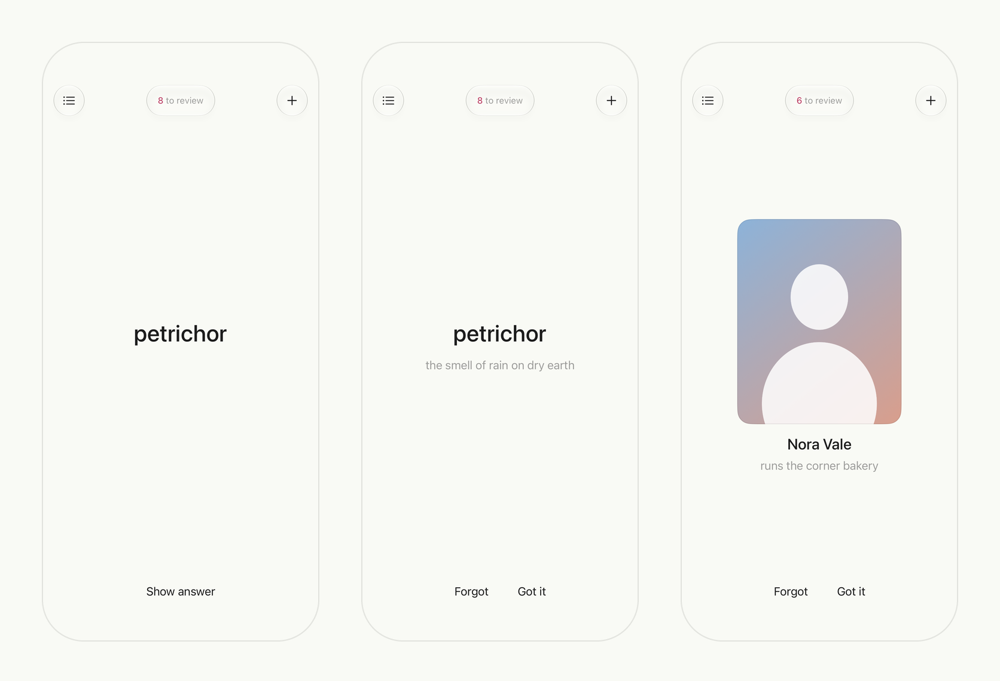
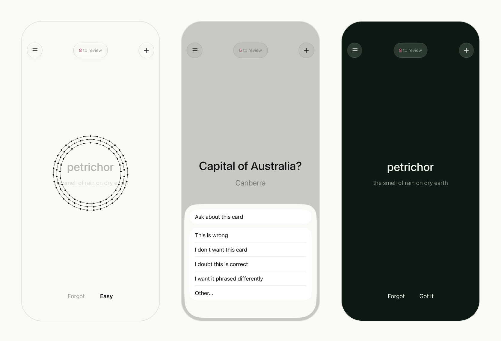
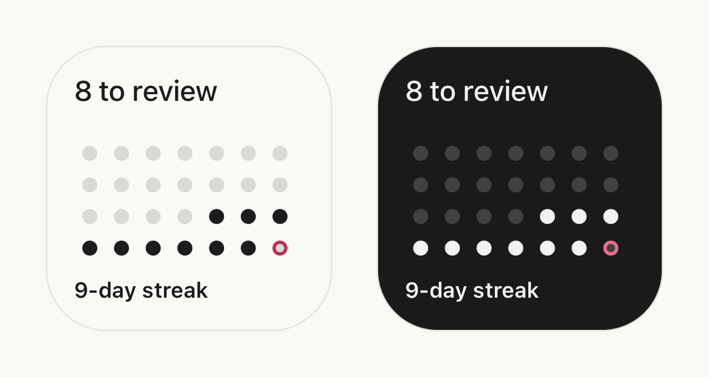

<p align="center">
  <picture>
    <source media="(prefers-color-scheme: dark)" srcset="docs/design/brand/logo-dark.svg">
    
  </picture>
</p>

<h1 align="center">la carte</h1>

<p align="center">Minimalist flashcards for iPhone. One deck, spaced repetition,<br>and any AI agent can add cards to it over MCP.</p>

<p align="center">
  <picture>
    <source media="(prefers-color-scheme: dark)" srcset="marketing/readme/study-dark.png">
    
  </picture>
</p>

## How it works

Open the app and you are already reviewing: one card in the middle of the screen. Tap to see the answer,
then *Forgot* or *Got it*. Each card is scheduled with [FSRS](https://github.com/open-spaced-repetition/py-fsrs),
so it comes back just before you would forget it.

<p align="center">
  
</p>

- **One deck.** Words, facts, people (a face, a name, who they are). Search it, add and edit cards.
- **Fix in place.** Double-tap to edit a card, ask an AI about it, or report it as wrong.
- **Calm.** Light, dark or forest. Large centered text, native controls, nothing else on screen.
- **Widget.** What's left to review and your streak, on the Home Screen.

<p align="center">
  
</p>

## Connect your agent

Making cards is the chore that stops most people. la carte's server speaks [MCP](https://modelcontextprotocol.io),
so you can tell any agent, in the middle of whatever you are doing, "add these to my deck", and the cards are on
your phone the next time you look.

```bash
claude mcp add --transport http la-carte https://deck.example.com/mcp \
  --header "Authorization: Bearer <your-token>"
```

Then ask: *"Add these to my deck: aurora, zenith, solace."* Any MCP client with streamable HTTP works the same way.

An agent can add, find, edit and delete cards (duplicate-safe), quiz you (its reviews count toward the same
schedule), read your stats, and fix the cards you reported. Ready-made prompts: *Quiz me*, *Make cards from text*,
*Add people*, *Handle reports*. The server asks agents to keep cards minimal: a word or short question on the
front, the shortest answer on the back.

## Self-host

The deck lives on your own server: one SQLite file behind one token. No account, no tracking.

```bash
echo "LA_CARTE_API_TOKEN=$(openssl rand -hex 32)" > .env   # the app and your agents need this token
docker compose up -d --build                               # REST for the app, MCP at /mcp
```

Put it behind HTTPS, then enter the server URL and token in the app's Settings. Reverse proxy, backups and a
Dokploy setup: [`docs/deploy.md`](docs/deploy.md). Building the app for your own iPhone:
[`docs/release.md`](docs/release.md).

To try it locally, run `scripts/api-dev.sh` (API on `http://127.0.0.1:8000`, no token needed) and the `LaCarte`
scheme from `ios/LaCarte.xcodeproj` on a simulator (Xcode with the iOS 26 SDK or later).

## Status

Early access: a few friends are trying it, and it is on its way to the App Store. Sign in with Google is coming
soon. Expect things to change.

## Contributing

Issues and pull requests are welcome. The app is SwiftUI with The Composable Architecture (`ios/`), the server
is Python, FastAPI and SQLite (`api/`). Build and test only through `scripts/` (see [`CLAUDE.md`](CLAUDE.md)),
and keep it simple: [`docs/architecture.md`](docs/architecture.md),
[`docs/design-system.md`](docs/design-system.md). The project is built by a team of Claude Code agents
(spec, implement, review, validate): [`docs/workflow.md`](docs/workflow.md).

## License

MIT, see [`LICENSE`](LICENSE).
